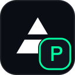
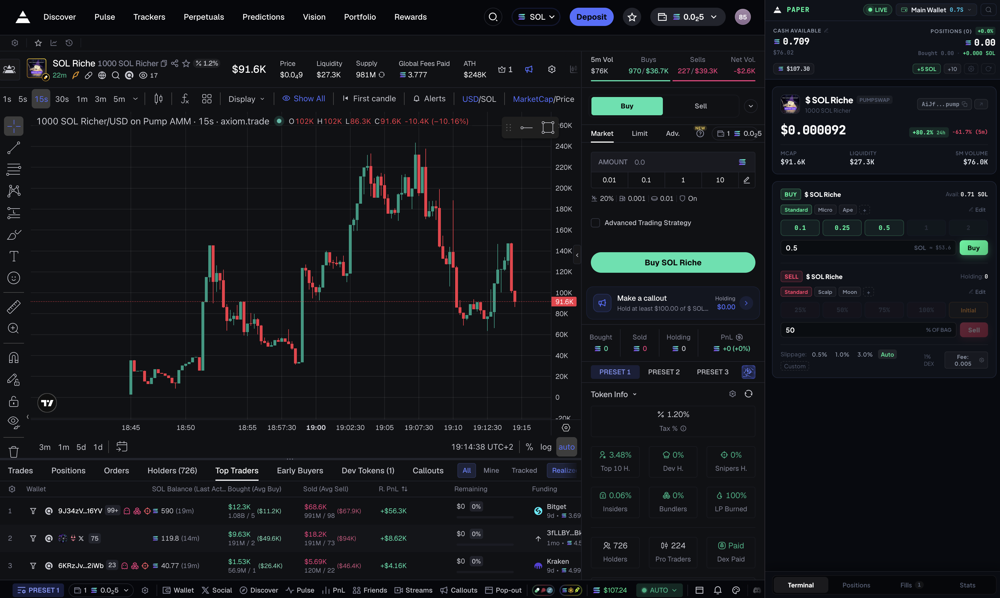
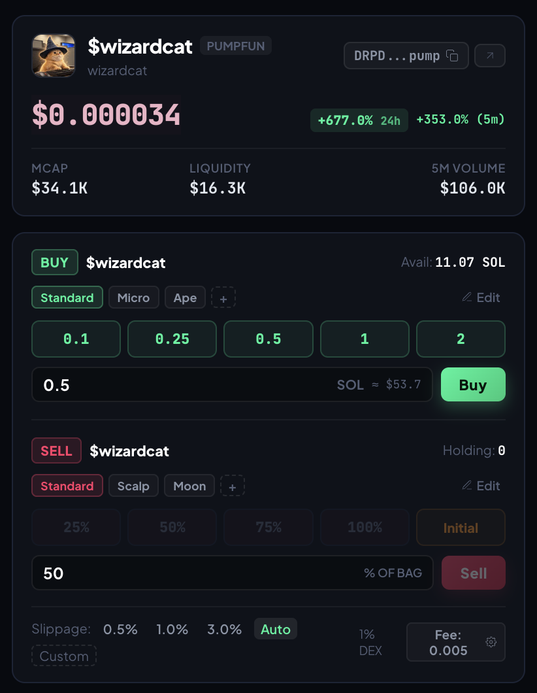
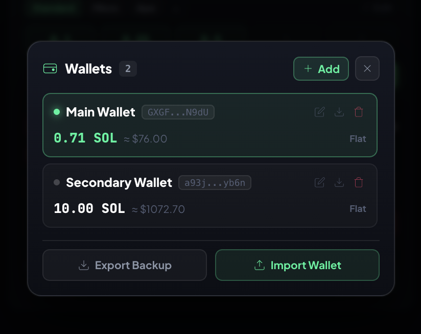
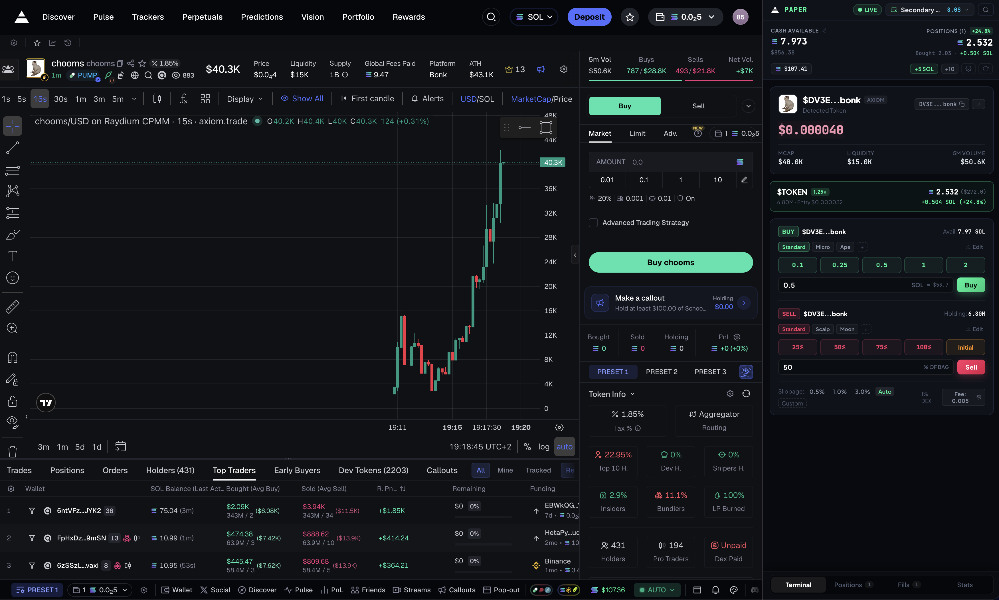
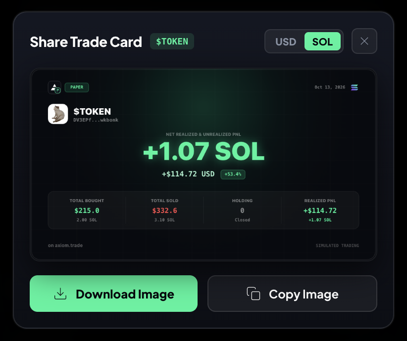

# PAPER MEME

### Realistic Solana meme coin paper trading simulator for axiom.trade

Practice trading without real capital, with actual DEX mechanics: price impact, liquidity curves, priority fee competition, dropped transactions, and shareable PnL cards.

  
    
    GPL v3.0
  
  
    
    Brave Sidebar · MV3
  
  
    
    
    Preact · TypeScript · Vite
  
  
    
    Google Antigravity
  

  

  <strong style="color: #f1e05a; font-size: 14.5px; display: block; margin-bottom: 4px;">Beta & Simulation Notice</strong>
  This project is in active development and might have occasional bugs or visual glitches. Because this extension is a 100% simulated sandbox, you do not connect any real Solana wallet or private keys. There is zero financial risk to your funds, but please expect minor quirks while features are being refined.

  

    Built with AI Disclosure
  

  

    This project was created and coded using AI assistance (Google DeepMind's Antigravity assistant) working together with <a href="https://github.com/notrealandy" style="color: #00f59b; text-decoration: none; font-weight: 600;">@notrealandy</a>.
  

---

## What is it?

Most paper trading tools give you fake instant fills at exact market prices with zero fees, which gives you unrealistic expectations.

Paper Meme runs in your Brave sidebar while you browse axiom.trade. It automatically reads the token you are viewing and simulates realistic DEX conditions:

  

    
AMM Price Impact

    
Constant-product math recalculates execution prices based on actual quote liquidity pools.

  

  

    
Priority Fee Simulator

    
Low bribe tips risk delayed fills or getting dropped entirely during heavy volume candles.

  

  

    
Multi-Wallet Sandbox

    
Test independent scalping, holding, and degen bags without crossing balances or metrics.

  

  

    
Shareable Stat Cards

    
High-resolution graphic cards ready to download or copy directly to clipboard in one click.

  

---

## Features

### 1. Terminal Trading Interface

Clean dark layout designed to sit in Brave's sidebar right next to your chart with live token data and rapid buy/sell controls.

  

  <ul style="margin: 0; padding-left: 20px; color: #cbd5e1; font-size: 13px; line-height: 1.8;">
    <li><strong style="color: #fff;">Auto token detection:</strong> picks up the token contract address straight from your active axiom.trade tab, or paste any Solana address manually.</li>
    <li><strong style="color: #fff;">Quick buy presets:</strong> configure custom SOL amounts for one-click buys.</li>
    <li><strong style="color: #fff;">Real-time slippage estimates:</strong> calculates price impact before orders go through.</li>
  </ul>

---

### 2. Multiple Wallets

Run multiple isolated paper wallets with their own balances, open positions, and trade histories.

  

  <ul style="margin: 0; padding-left: 20px; color: #cbd5e1; font-size: 13px; line-height: 1.8;">
    <li><strong style="color: #fff;">Simulated Solana addresses:</strong> creates random base58 public keys with a quick copy button.</li>
    <li><strong style="color: #fff;">Separate tracking:</strong> balances, bags, and trade logs stay isolated per wallet.</li>
    <li><strong style="color: #fff;">Quick switching:</strong> switch active wallet with one click from the header.</li>
    <li><strong style="color: #fff;">Rename and delete:</strong> edit wallet names or remove old wallets directly in the popup.</li>
  </ul>

---

### 3. Open Positions and Real-Time Tracking

Track active bags alongside charts with live unrealized PnL, entry multipliers, and instant bag scaling.

  

  <ul style="margin: 0; padding-left: 20px; color: #cbd5e1; font-size: 13px; line-height: 1.8;">
    <li><strong style="color: #fff;">Live valuations:</strong> prices update continuously against DexScreener feeds.</li>
    <li><strong style="color: #fff;">Sell Initial:</strong> sell only your initial invested amount and let the remaining tokens ride as house money.</li>
    <li><strong style="color: #fff;">Percentage sells:</strong> sell 25%, 50%, 75%, or 100% of any position with one click.</li>
  </ul>

---

### 4. Shareable PnL Cards

Create clean stat cards to share your trade results.

  

  <ul style="margin: 0; padding-left: 20px; color: #cbd5e1; font-size: 13px; line-height: 1.8;">
    <li><strong style="color: #fff;">Two modes:</strong> export cards for a single token trade or your whole wallet portfolio.</li>
    <li><strong style="color: #fff;">Currency toggle:</strong> choose whether SOL or USD is the main highlighted number.</li>
    <li><strong style="color: #fff;">Trade details:</strong> shows trade date range, token icon, and wallet name in all caps.</li>
    <li><strong style="color: #fff;">One-click export:</strong> copy the card directly to your clipboard or download it as a PNG.</li>
  </ul>

---

## Project Structure

  paper_meme/ 
  ├── src/ 
  │   ├── app.tsx &nbsp;&nbsp;&nbsp;&nbsp;&nbsp;&nbsp;&nbsp;&nbsp;&nbsp;&nbsp;&nbsp;&nbsp;&nbsp;&nbsp;&nbsp;&nbsp;&nbsp;# Main application component and state 
  │   ├── WalletManagerModal.tsx &nbsp;# Wallet switcher and import/export modal 
  │   ├── SharePnlModal.tsx &nbsp;&nbsp;&nbsp;&nbsp;&nbsp;&nbsp;# Canvas card generator for PnL sharing 
  │   ├── background.ts &nbsp;&nbsp;&nbsp;&nbsp;&nbsp;&nbsp;&nbsp;&nbsp;&nbsp;&nbsp;# Extension background service worker 
  │   └── content.ts &nbsp;&nbsp;&nbsp;&nbsp;&nbsp;&nbsp;&nbsp;&nbsp;&nbsp;&nbsp;&nbsp;&nbsp;&nbsp;# Content script to read contract address from page 
  ├── public/ 
  │   └── icons/ &nbsp;&nbsp;&nbsp;&nbsp;&nbsp;&nbsp;&nbsp;&nbsp;&nbsp;&nbsp;&nbsp;&nbsp;&nbsp;&nbsp;&nbsp;&nbsp;&nbsp;# Extension icons 
  ├── manifest.json &nbsp;&nbsp;&nbsp;&nbsp;&nbsp;&nbsp;&nbsp;&nbsp;&nbsp;&nbsp;&nbsp;&nbsp;&nbsp;&nbsp;# Manifest V3 extension configuration 
  └── vite.config.ts &nbsp;&nbsp;&nbsp;&nbsp;&nbsp;&nbsp;&nbsp;&nbsp;&nbsp;&nbsp;&nbsp;&nbsp;&nbsp;# Vite + Preact build setup

---

## How to Install and Run

### 1. Build from Source

  

    

      
      
      
    

    bash / zsh
  

  

    # 1. Clone repository 
    git clone https://github.com/notrealandy/paper_meme.git 
    cd paper_meme  
    # 2. Install dependencies & build extension 
    yarn install 
    yarn build
  

### 2. Load Extension in Brave (or Chrome)

  <ol style="margin: 0; padding-left: 20px; color: #cbd5e1; font-size: 13px; line-height: 1.8;">
    <li>Go to <code style="background: rgba(255, 255, 255, 0.08); padding: 2px 6px; border-radius: 4px; color: #00f59b;">brave://extensions/</code> (or <code style="background: rgba(255, 255, 255, 0.08); padding: 2px 6px; border-radius: 4px; color: #00d4ff;">chrome://extensions/</code>) in your browser.</li>
    <li>Turn on <strong style="color: #fff;">Developer mode</strong> in the top right.</li>
    <li>Click <strong style="color: #fff;">Load unpacked</strong>.</li>
    <li>Select the <code style="background: rgba(255, 255, 255, 0.08); padding: 2px 6px; border-radius: 4px; color: #e2e8f0;">dist</code> folder inside the <code style="background: rgba(255, 255, 255, 0.08); padding: 2px 6px; border-radius: 4px; color: #e2e8f0;">paper_meme</code> directory.</li>
    <li>Open <a href="https://axiom.trade" style="color: #00f59b; text-decoration: none;">axiom.trade</a> and launch the extension from your sidebar or extensions menu.</li>
  </ol>

### 3. Development Mode

  

    Live watcher with auto-rebuild:
    terminal
  

  

    yarn dev
  

---

## Backup and Export

All trade and wallet data is saved in your browser storage (`chrome.storage.local` and `localStorage`).

  

    
Single Wallet Export

    
Export individual wallet balances, positions, and trades to a single JSON file.

  

  

    
Full Archive Backup

    
Export all wallets, buy/sell presets, fees, and active configs in one file.

  

  

    
Seamless Restore

    
Import any previous JSON file to instantly restore your trading terminal state.

  

 
---

## License

This project is licensed under the GNU General Public License v3.0. See the [GNU_GPLv3-LICENSE](GNU_GPLv3-LICENSE) file for details.
